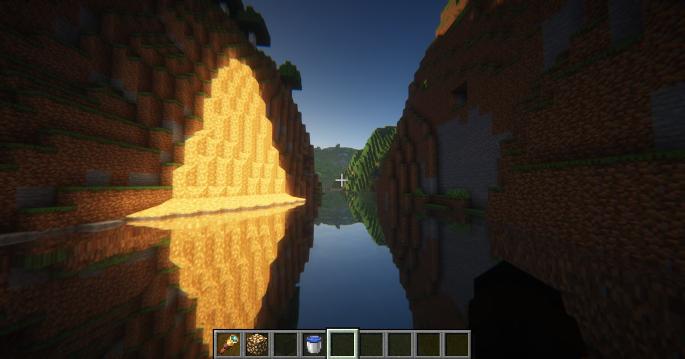
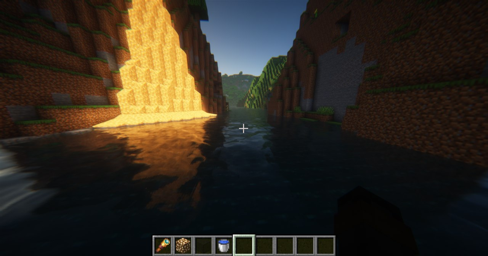
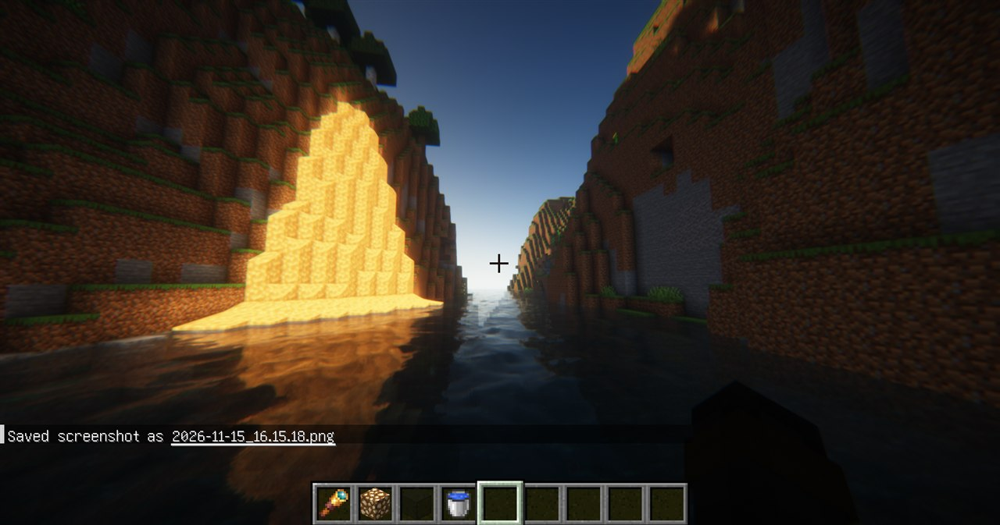
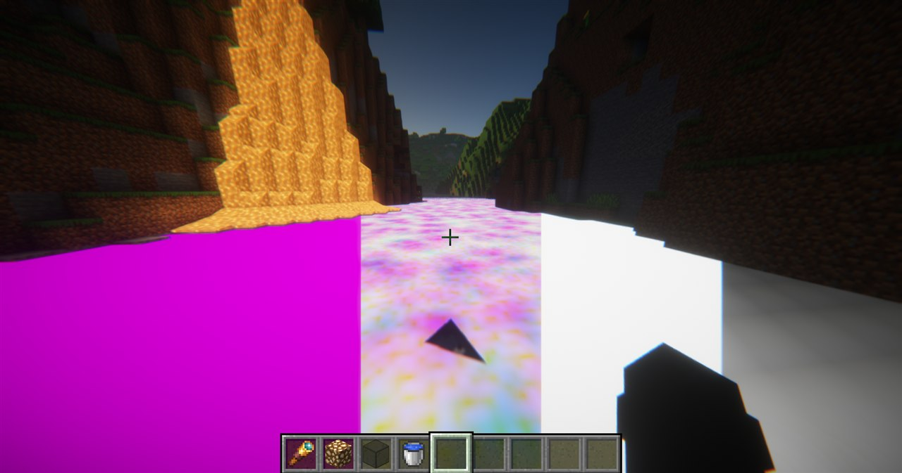
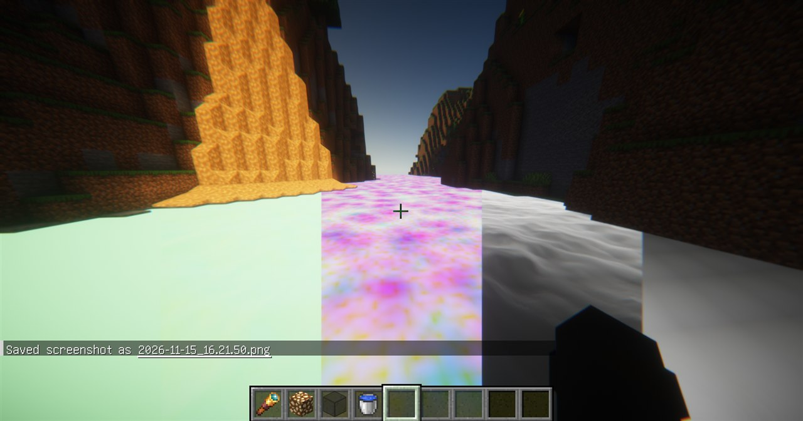

# BSL + Distant Horizons: water/glass normal fix

A small patch for **BSL Shaders v10.1.8** that fixes flat, mirror-like water (and glass) when
**Distant Horizons (DH)** is rendering under Iris.

> **This repository does not contain BSL Shaders.** BSL is © Capt Tatsu, all rights reserved
> (see [Legal](#legal)). You download BSL yourself; the script here patches *your* copy locally.

## The problem

With DH rendering, vanilla water close to the camera turns into an almost perfect, flat mirror:
no waves, much higher opacity, darker tint, sharp reflections of everything. Glass blocks and the
side faces of water blocks show the same glitch. With DH off the water is fine. Disabling BSL's
reflections does not help, and the opacity jump stays.

| BSL, DH on (the bug) | BSL + this fix, DH on | BSL, DH off (reference) |
|:---:|:---:|:---:|
|  |  |  |

<sub>Same spot and view. The screenshots were taken while developing the patch, on an instrumented copy of the pack that
also kept the water alpha constant (Fresnel not mixed into alpha); the glitch looked the same on stock BSL, and the fix
code is the one in this repository.</sub>

## The cause (measured)

With DH active, the **vertex normal of vanilla translucent geometry arrives inverted**: the top face
of a water block is `(0, -1, 0)` instead of `(0, +1, 0)`.

I measured it by painting the world-space normal on the water (`mat3(gbufferModelViewInverse) * normal * 0.5 + 0.5`)
and the Fresnel term, in the same spot with DH on and off:

| Quantity on the water | DH on | DH off |
|---|---|---|
| vertex normal, world space (screen RGB) | `(194, 0, 195)` → `n.y ≤ -1` | `(181, 216, 181)` → `n.y = +1` |
| Fresnel (screen RGB, grey) | `190` (saturated, ≈ 1) | `52` (low) |

The debug view paints five vertical strips over the water (left to right): **1** world-space vertex normal,
**2** final normal after the waves, **3** `noisetex` sample, **4** Fresnel, **5** `|reconstructed distance / true distance − 1|`.
A flat water top must be pale green `(0.5, 1, 0.5)` in strips 1–2; strips 3 and 5 are identical with DH on and off, so the noise
texture and the depth reconstruction are fine. (The dark shape in the DH-on image is a squid.)

| DH on | DH off |
|:---:|:---:|
|  |  |

<details>
<summary>How the strips were made</summary>

Paste at the end of the main block of the fragment shader of `gbuffers_water.glsl`, just before the `#if ALPHA_BLEND == 0`
that takes the square root (all the variables already exist there). Use it only for diagnosis.

```glsl
{
	float dbgStrip = floor(gl_FragCoord.x / viewWidth * 5.0);
	vec3 dbg = vec3(0.0);
	if (dbgStrip < 0.5) dbg = mat3(gbufferModelViewInverse) * normalize(normal) * 0.5 + 0.5;
	else if (dbgStrip < 1.5) dbg = mat3(gbufferModelViewInverse) * normalize(newNormal) * 0.5 + 0.5;
	else if (dbgStrip < 2.5) dbg = texture2D(noisetex, fract((worldPos.xz + cameraPosition.xz) / 64.0)).rgb;
	else if (dbgStrip < 3.5) dbg = vec3(fresnel);
	else dbg = vec3(clamp(abs(viewLength / dist - 1.0) * 10.0, 0.0, 1.0));
	albedo = vec4(dbg, 1.0);
}
```

</details>

The rest of BSL then does exactly what it is told:

* `fresnel = pow(clamp(1 + dot(n, viewDir), 0, 1), k)` goes to 1 → total mirror, higher opacity.
* `GetWaterNormal` scales the waves by `0.35 * (1 - fresnel)` → 0 → **waves disappear**.
* `reflect(v, n)` does not depend on the sign of `n` → reflections stay geometrically perfect, which is why it looks like a flawless mirror.

Ruled out in-game (switching each off or painting it, DH on): chunk fade, tangent frame, DH water (`dh_water`),
DH terrain (`dh_terrain`), screen-space reflections, fog, alpha, light-shaft tint, `noisetex`, depth reconstruction,
time, lightmap.

**Not known:** *who* flips the normal (Iris, Sodium or DH). The wrong sign comes in with the vertex attribute.
Opaque terrain is not affected. See [Help wanted](#help-wanted).

## The fix

In the vertex shader of `gbuffers_water`, the normal is re-oriented from the geometry instead of trusting its sign:
seen from outside, a face looks at the camera; water seen from *inside* water looks away from it.

```glsl
#if WATER_NORMAL_FIX == 1
{
	float facing = dot(normal, (gl_ModelViewMatrix * gl_Vertex).xyz); // > 0: normal points away from the camera
	bool waterFace = (blockID == 200 || blockID == 204 || blockID == 205);
	bool wantAway = waterFace && isEyeInWater == 1;
	if (wantAway ? facing < 0.0 : facing > 0.0) {
		normal = -normal;
		binormal = -binormal;
	}
}
#endif
```

If the normals are already correct the block changes nothing. It is behind a shader option, so you can compare.

## Usage

1. Download **BSL Shaders v10.1.8** from its official page ([Modrinth](https://modrinth.com/shader/bsl-shaders),
   CurseForge, or [capttatsu.com](https://capttatsu.com)).
2. Run the patcher (Python 3.8+, standard library only):

   ```
   python apply_patch.py path/to/BSL_v10.1.8.zip
   ```

   This writes a new folder-pack `BSL_v10.1.8_NORMAL-PATCH` next to the zip. The input is never modified.
   Use `--out <folder>` to choose the destination. The script refuses to overwrite anything, checks that it is
   really BSL v10.1.8, and leaves nothing half-patched if an anchor is not found.
3. Copy the folder into `.minecraft/shaderpacks/` (as a **folder**, not zipped) and select it in the Iris shader menu.
4. Option: **Shader options → Environment → Water → Normal Fix (DH)** (ON by default; OFF = original BSL).

The Water screen is also tidied: the `<empty>` spacers are removed and `screen.WATER.columns=3` is set, so the 15 options form
a 3 × 5 grid (without it Iris picks 2 columns for 15 options).

### Manual install

If you prefer to edit by hand, the changes to a fresh BSL v10.1.8 are:

| File | Change |
|---|---|
| `shaders/program/gbuffers_water.glsl` | in the **vertex** shader uniforms add `uniform int isEyeInWater;`, and paste the block above right after the line `tangent  = normalize(gl_NormalMatrix * at_tangent.xyz);` |
| `shaders/lib/settings.glsl` | add `#define WATER_NORMAL_FIX 1 //[0 1]` after the `WATER_PIXEL` line |
| `shaders/shaders.properties` | append `WATER_NORMAL_FIX` to `screen.WATER` (optionally remove its `<empty>` entries and add `screen.WATER.columns=3`) |
| `shaders/lang/en_US.lang` | add `option.WATER_NORMAL_FIX=…` / `value.WATER_NORMAL_FIX.0/1=…` |

## Tested on

One machine (Windows, NVIDIA GPU): Minecraft 26.3, Iris 1.11.7, Sodium 0.9.3-beta.1, Distant Horizons 3.3.4, BSL v10.1.8,
DH transparency `COMPLETE`. Reports for other versions (and other GPUs) are welcome.

## Known limits

* Glass seen from inside a room: the normal now always faces the camera, so its Fresnel can look slightly different from stock BSL.
* While underwater, *another* body of water seen from the outside may get an inverted normal.
* The waves' noise pattern looks mirrored compared with a build where the normal is correct. Visually it is close.
* Only `gbuffers_water` is patched. Entities/hand/other translucent programs are untouched.

## Help wanted

Finding **which component inverts the normal** would let it be fixed at the source (and probably for every shader pack, not just BSL).
Candidates: the Iris/DH compat, Sodium's translucent mesh, or DH's render-state handling. A good first check is whether raw
`gl_Normal` is already inverted, or whether `gl_NormalMatrix` is the culprit. If you know, please open an issue.

A possibly related symptom (water inside the vanilla render distance changing when DH transparency is `COMPLETE`) is reported in
[DH issue #861](https://gitlab.com/distant-horizons-team/distant-horizons/-/work_items/861).

## Legal

* **BSL Shaders is © Capt Tatsu.** Its listed license is *All rights reserved*; the author's terms allow modifying the pack for personal
  use, and forbid redistributing it without permission (publishing a heavily modified version also needs permission).
* This repository ships **no BSL files**. The patcher only contains the new code plus a few single-line anchors it needs to find
  where to insert it.
* The patched output is for **your personal use only**. Please do not upload it anywhere.
* Not affiliated with or endorsed by Capt Tatsu, Iris, Sodium or Distant Horizons.
